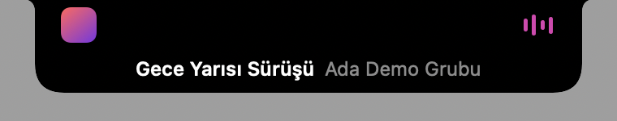
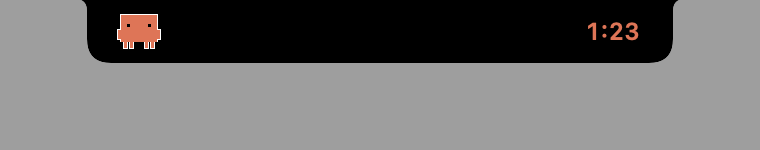
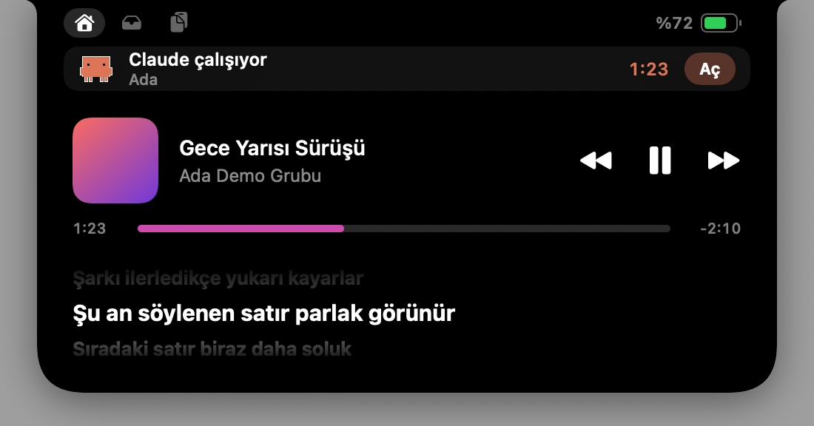
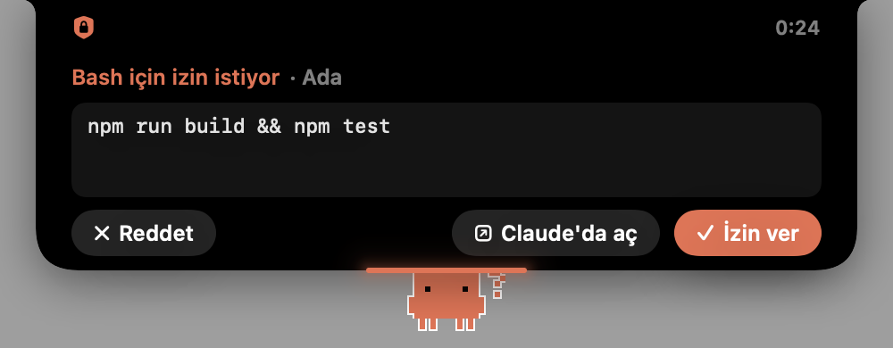
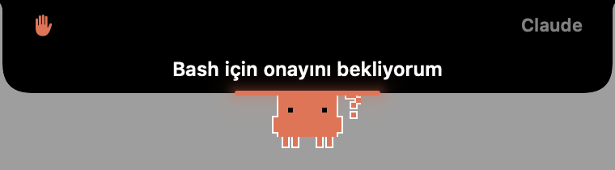
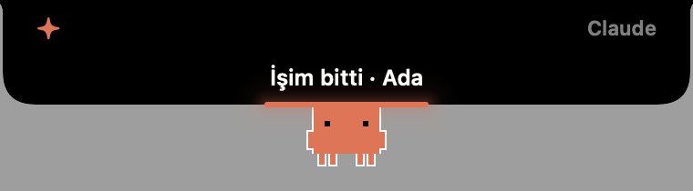
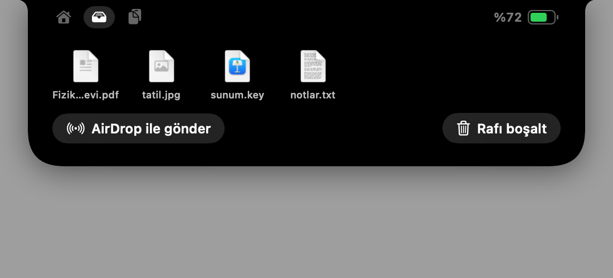
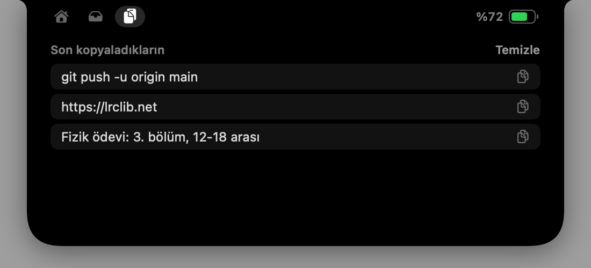

# Ada 🏝️

**A Dynamic Island for your MacBook's notch**: now playing with synced lyrics, a live activity for Claude Code that lets you answer its permission requests from the notch, a file shelf with AirDrop, clipboard history, a volume indicator and your next calendar event.

**English** · [Türkçe](README.tr.md)

*Ada* means "island" in Turkish. It sits on top of your MacBook's notch and quietly grows into a small island when something happens: a song starts, you plug in the charger, Claude Code asks for permission or finishes a task.

<p align="center">
  
  
</p>
<p align="center">
  
</p>
<p align="center">
  
</p>
<p align="center">
  
  
</p>
<p align="center">
  
  
</p>

> The screenshots are rendered by the app itself (`--snapshot`) with demo data. The lyrics, files and clipboard items in them are made up.

## Features

### 🎵 Music
- **Compact view while playing**: album art on the left, an equalizer tinted with the artwork's color on the right, and *song · artist* right under the notch.
- **Hover to expand**: artwork, title, ⏮ ⏯ ⏭ and a draggable progress bar. Click the artwork to bring the player to the front.
- **Synced lyrics** from [LRCLIB](https://lrclib.net). The current line is highlighted and the lines scroll with the song. If a song has no lyrics, the section simply doesn't appear.
- **Two-finger swipe** on the expanded panel: right → next track, left → previous. The trackpad gives a light tick when the swipe is far enough.
- **Smart idle**: after the music has been paused for 2 minutes, the panel goes back to the clock and date, with a "Last played ▶" button to resume.
- Works with the **Music** app (Apple Music) and the **Spotify** app.

### 🤖 Claude Code live activity
A pixel mascot tells you what [Claude Code](https://claude.com/claude-code) is doing. It works through Claude Code hooks (see [setup](#claude-code-integration-optional)).

| When | On the notch |
|---|---|
| You send a prompt | Mini mascot walking on the left, elapsed time (`1:23`) on the right |
| Claude asks for permission | A card with the tool, the folder and the command, a countdown, and **Reddet** (Deny) · **Claude'da aç** (Open in Claude) · **İzin ver** (Allow) |
| Claude is waiting in its own dialog | The mascot comes out with a bouncing **?**: "waiting for your approval for Bash" |
| Claude finishes | An orange line glows and the mascot comes out: "done · *folder*" for 10 seconds, then a ✓ badge stays until you look |

Hover over the notch to see a Claude row at the top of the panel. Click **Aç** (Open) to bring the Claude app to the front. The ✓ badge goes away when you open the panel, switch to Claude, or send a new prompt. If you use Claude Code in a terminal, the row also shows your **usage limits**: "5 sa %42 · hafta %18" means 42% of the 5-hour window and 18% of the weekly window are used.

#### Answering permission requests from the notch
When Claude Code is about to ask for a permission, Ada shows the request on the notch, so you can answer without switching apps.
- **İzin ver** (Allow) allows **this one request only**. Ada never adds permission rules or changes the permission mode.
- **Reddet** (Deny) denies it and tells Claude it was denied from Ada.
- **Claude'da aç** (Open in Claude), or no answer within **30 seconds**, hands the request back to Claude's own permission dialog, as if Ada weren't there.
- If you use the Claude app and it's already in front, Ada stays out of the way and Claude shows its own dialog right away.
- When the whole command doesn't fit on the card (over 180 characters), there's no Allow button. Read it in Claude first.
- For the first 0.8 seconds after a card appears, Allow clicks are ignored, so a click meant for something else can't approve a request.
- Questions (`AskUserQuestion`) and plan approval always stay in Claude.
- The answer travels over a local socket that only your user account can open, and only a click on the card can send Allow.

### 🗂️ File shelf
Drag a file to the notch and the panel opens on the **shelf** tab; drop it there. Later, drag it out anywhere, click it to open it, or right-click for *Show in Finder*, *AirDrop* and *Remove*. **AirDrop ile gönder** (Send with AirDrop) sends everything on the shelf. Ada only remembers where the files are (up to 12); it doesn't copy them.

### 📋 Clipboard history (off by default)
The **clipboard** tab keeps the last 10 pieces of text you copied. Click one to copy it again. Turn it on from the tab or from the menu bar icon.
- Memory only: nothing is written to disk, and the list is gone when Ada quits.
- Items that password managers mark as concealed are skipped.
- Newer macOS versions ask before an app reads the clipboard. Set Ada to "always allow" in System Settings (Privacy & Security). Otherwise Ada stops reading the clipboard instead of making macOS ask on every copy.

### ⚡ Also
- **Volume indicator**: when the volume changes, a speaker and a level bar appear on the notch. Ada only *reads* the volume; it never changes it.
- **Next event**: when nothing is playing, the panel shows your next calendar event in the next 24 hours ("Physics · 16:19 · in 25 min"). Ada asks for calendar access only when you click **Takvimi göster** (Show calendar), and it only reads.
- **Charging alert**: "⚡ Charging 72%" when you plug in.
- **Terminal messages**: `ada "build finished"` shows up on the notch.
- **Launch at login** and a menu bar icon with toggles.
- **Lightweight**: about 37 MB of RAM and ~1% CPU when idle. Always-on animations run on Core Animation, not the app.

> **Note:** the app's own interface text is in Turkish for now.

## Requirements
- A MacBook with a notch. On other Macs, Ada appears as a small pill at the top center.
- macOS 14 or later (developed on macOS 27).
- Xcode, **or** just the Command Line Tools: `xcode-select --install` (Swift 5.9+).
- The Music app or the Spotify app for now playing.

## Install

### With Homebrew
```bash
brew tap lonlyexe0/ada https://github.com/lonlyexe0/Ada
brew install --HEAD lonlyexe0/ada/ada
ditto "$(brew --prefix)/opt/ada/Ada.app" ~/Applications/Ada.app && open ~/Applications/Ada.app
```
Homebrew builds Ada from source and also installs the `ada` command for [terminal messages](#terminal-messages-optional). Copying the app to `~/Applications` keeps launch at login and the Claude Code hooks working. To update: `brew upgrade --fetch-HEAD ada`, then copy it again.

### From source
```bash
git clone https://github.com/lonlyexe0/Ada.git
cd Ada
./build.sh
```
`build.sh` compiles the app, installs it as `~/Applications/Ada.app` and launches it. On first launch Ada adds itself to Login Items; you can turn this off from the menu bar icon.

When macOS asks **"Ada wants to control Music"**, click **Allow**. That's how Ada reads the current song.

- Quit: menu bar capsule icon → **Ada'dan çık** (Quit Ada).
- Build only, without installing: `./build.sh --no-run`.

## Claude Code integration (optional)
Copy the `"hooks"` section from [`scripts/claude-hooks.json`](scripts/claude-hooks.json) into `~/.claude/settings.json`, plus `"statusLine"` if you want the usage limits. If you already have hooks there, merge them instead of replacing. If you already have a status line, keep yours and skip `statusLine`.

| Hook | What it sends to Ada |
|---|---|
| `UserPromptSubmit` | Claude started working → mini mascot + timer |
| `PostToolUse` | A tool finished → back to "working" (e.g. after you approve something) |
| `Notification` | Claude is waiting in its own dialog → mascot with "?" |
| `PermissionRequest` | Claude asks for permission → the card on the notch. Claude waits up to 30 seconds for your answer, then shows its own dialog. |
| `Stop` | Claude finished → notification + ✓ badge |
| `statusLine` | Terminal Claude Code only: usage limits for the Claude row |

The first three hooks run in the background and take about 0.07 s each, so they don't slow Claude down. `PermissionRequest` has to wait for your answer. To change the 30-second window, put `ADA_PERMISSION_WAIT=15` in front of its command. Claude Code may need a new session to pick up new hooks.

## Terminal messages (optional)
Homebrew already installs the `ada` command. If you built from source:
```bash
mkdir -p ~/.local/bin
cp scripts/ada ~/.local/bin/ && chmod +x ~/.local/bin/ada
echo 'export PATH="$HOME/.local/bin:$PATH"' >> ~/.zshrc   # then open a new terminal window

ada "lab7 finished!"
python3 long_job.py; ada "Job done"
```

## Menu bar
The capsule icon in the menu bar has:
- **Mac açılınca başlat**: launch at login
- **Claude maskotunu göster**: show the Claude mascot (the line and the text still appear when it's off)
- **Ses göstergesi**: volume indicator
- **Pano geçmişi**: clipboard history
- **Ada'dan çık**: quit

## Troubleshooting
| Problem | Try |
|---|---|
| The song doesn't show up | `open -n -W --stdout /tmp/ada.txt ~/Applications/Ada.app --args --probe; cat /tmp/ada.txt` asks Music step by step and prints what it answers. |
| You denied the Music permission | System Settings → Privacy & Security → Automation → Ada → Music, or `tccutil reset AppleEvents local.ada.island` |
| Does a song have lyrics? | Same probe command with `--probe --song "Song" --artist "Artist"` (prints only the line count) |
| The permission card doesn't appear | Check that `PermissionRequest` is in `~/.claude/settings.json` and start a new Claude Code session. If the Claude app is in front, Ada lets Claude ask directly on purpose. `tail ~/Library/Logs/Ada.log` shows `izin isteği` when a request arrives. |
| The clipboard tab says macOS keeps asking | In System Settings (Privacy & Security), set Ada's clipboard access to "always allow". |
| You denied calendar access | System Settings → Privacy & Security → Calendars → Ada |
| See the design without opening a window | `build/Ada.app/Contents/MacOS/Ada --snapshot snapshots` renders every state as PNG |
| Is launch at login on? | `open -n -W --stdout /tmp/ada.txt ~/Applications/Ada.app --args --login-status; cat /tmp/ada.txt` |
| Did a message or hook reach Ada? | `tail ~/Library/Logs/Ada.log` (only the event type is logged, never content) |

## How it works
- **Now playing**: AppleScript queries the Music / Spotify app every 1.5 s, plus an instant update when the app broadcasts a change. Commands like play/pause and seek also go through AppleScript.
- **Lyrics**: [LRCLIB](https://lrclib.net) (free, no API key). It tries an exact match first (title, artist, album, duration), then a search; it skips versions whose length differs by more than 10 s.
- **Messages and hooks**: `Ada --say` / `Ada --claude-event` post a system-wide distributed notification, and the running Ada picks it up.
- **Permission requests**: the hook (`Ada --claude-permission`) connects to `~/Library/Application Support/Ada/permission.sock` (folder 700, socket 600), sends a short summary of the request and waits. The running Ada shows the card and answers with your click. On timeout it answers "pass", the hook prints nothing, and Claude shows its own dialog. If the hook goes away (you stopped Claude), the card disappears.
- **Usage limits**: `Ada --statusline` reads `rate_limits` from the status line's input and forwards the percentages to Ada.
- **File drags**: when you press the mouse button, Ada notes the drag pasteboard's change counter. If it changes and holds file URLs while the button is down, a file is being dragged, and the panel opens on the shelf when you reach the notch. Nothing is read until you drop.
- **Volume**: CoreAudio property listeners on the default output device (read-only).
- **Calendar**: EventKit, read-only, refreshed when your calendars change and every 5 minutes.
- **The window**: a borderless, click-through panel above the menu bar, sized to the notch using `NSScreen.safeAreaInsets` and `auxiliaryTopLeftArea` / `auxiliaryTopRightArea`.
- **Animations**: the equalizer and the mascot are Core Animation layers, so they cost almost no CPU. Driving them with SwiftUI's `TimelineView` re-rendered the whole window on every frame (~6% CPU even when idle).
- **No Xcode needed**: it builds with SwiftPM and the Command Line Tools. With only the Command Line Tools on the macOS 27 SDK, SwiftUI's `@State` macro isn't available, so the code doesn't use `@State`.

## Privacy
- **Lyrics**: the song's title, artist, album and duration are sent to lrclib.net. Nothing else leaves your Mac (apart from Spotify's own artwork URLs).
- **Claude Code hooks**: Ada reads only the session id, the folder name and the notification text. It never reads your prompts or Claude's answers.
- **Permission requests**: the tool name, the folder name and a short summary of the request (at most 180 characters, e.g. the command) go from Claude Code to Ada over the local socket. Only the tool name is logged.
- **Clipboard**: off by default, kept in memory only, and concealed or transient items (password managers) are skipped.
- **File shelf**: only the file paths are saved, in Ada's preferences.
- **Calendar**: read only after you allow it; events stay on your Mac.
- **Log file**: only event types and message lengths are written, never their content.
- No analytics, no accounts.

## Limitations
- Music playing in a browser (YouTube, Spotify Web) isn't shown. Since macOS 15.4, Apple restricts the system's now-playing data to its own apps.
- No brightness indicator: macOS has no public API that reports brightness changes.
- Usage limits appear only if you use Claude Code in a terminal; the Claude desktop app has no status line.
- Answering from the notch works for 30 seconds; after that the request goes back to Claude's own dialog. Long commands (over 180 characters) have to be approved in Claude.
- The app is signed ad hoc, so build it yourself (`./build.sh` or Homebrew) rather than downloading a prebuilt copy.

## Project structure
| File | What it does |
|---|---|
| `AdaMain.swift` | Entry point and command-line flags (`--say`, `--claude`, `--claude-permission`, `--statusline`, `--probe`, `--snapshot`, ...) |
| `AppDelegate.swift` | Menu bar icon and menu, launch at login |
| `IslandController.swift` | Window above the notch, mouse tracking, states and sizes, swipe gestures, file drag detection |
| `IslandViews.swift` | All SwiftUI views of the island (compact states, permission card, expanded panel with tabs) |
| `Components.swift` | Notch shape, equalizer, battery, buttons, progress bar |
| `NowPlaying.swift` | Reading and controlling the current song |
| `AppleScript.swift` | The AppleScripts sent to Music / Spotify |
| `Lyrics.swift` | LRCLIB client, LRC parser, scrolling lyrics view |
| `Mascot.swift` | The pixel mascot (big and mini) on Core Animation |
| `ClaudeActivity.swift` | What Claude is doing: working, waiting, or done; usage limits |
| `Permissions.swift` | Answering permission requests from the notch: local socket, request queue, `--claude-permission` hook |
| `Usage.swift` | Usage limits from the status line (`--statusline`) |
| `Shelf.swift` | File shelf tab, drag and drop, AirDrop |
| `Clipboard.swift` | Clipboard history tab (memory only) |
| `Agenda.swift` | Next calendar event (EventKit, read-only) |
| `Volume.swift` | Volume indicator (CoreAudio, read-only) |
| `Messages.swift` | Terminal and Claude messages, `~/Library/Logs/Ada.log` |
| `Battery.swift` | Battery level and charger events |
| `Snapshot.swift` / `Probe.swift` | `--snapshot` and `--probe` developer tools |
| `Formula/ada.rb` | Homebrew formula |

## Disclaimer
Ada is an unofficial fan project, not affiliated with or endorsed by Apple or Anthropic. "Claude" is a trademark of Anthropic, and the pixel mascot is a fan-made tribute. Song lyrics belong to their respective owners; none are bundled with this project. They're fetched at runtime from LRCLIB.
