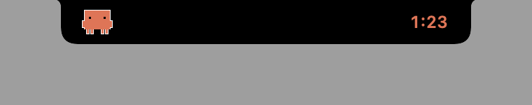
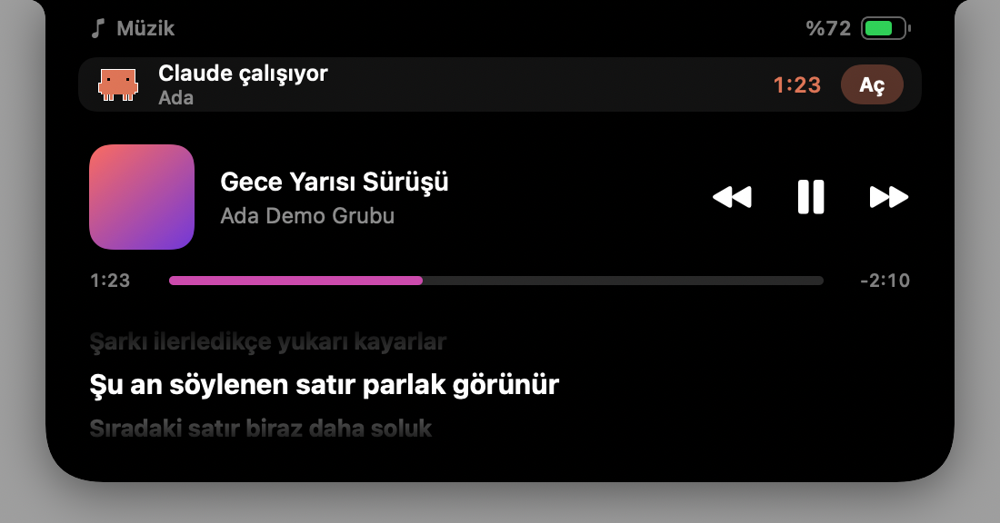
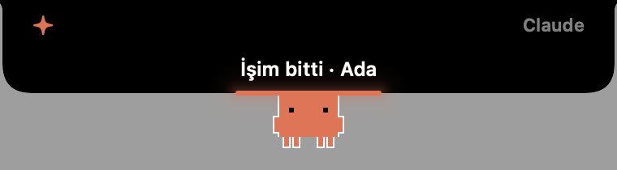

# Ada 🏝️

**MacBook çentiği için Dinamik Ada**: zamanlı şarkı sözleriyle müzik, kaydırarak şarkı değiştirme, şarj bildirimi ve Claude Code için canlı etkinlik.

[English](README.md) · **Türkçe**

Ada, MacBook'unun çentiğinin üstüne oturur ve bir şey olduğunda küçük bir adaya dönüşür: bir şarkı başladığında, şarj kablosunu taktığında ya da Claude Code işini bitirdiğinde.

<p align="center">
  
  
</p>
<p align="center">
  
</p>
<p align="center">
  
  
</p>

> Ekran görüntülerini uygulamanın kendisi örnek verilerle çiziyor (`--snapshot`). İçlerindeki şarkı sözleri uydurma örnek metin.

## Özellikler

### 🎵 Müzik
- **Çalarken küçük görünüm:** solda albüm kapağı, sağda kapağın renginde zıplayan ekolayzer, çentiğin hemen altında *şarkı · sanatçı*.
- **Üstüne gelince büyür:** kapak, şarkı adı, ⏮ ⏯ ⏭ ve sürüklenebilir ilerleme çubuğu. Kapağa tıklarsan müzik uygulaması öne gelir.
- **Zamanlı şarkı sözleri:** [LRCLIB](https://lrclib.net)'ten gelir. O an söylenen satır parlak görünür, satırlar şarkıyla birlikte kayar. Sözü olmayan şarkılarda bu alan hiç çıkmaz.
- **İki parmakla kaydırma:** panel açıkken sağa kaydırınca sonraki şarkı, sola kaydırınca önceki şarkı. Yeterince kaydırınca trackpad hafifçe "tık"lar.
- **Akıllı boşta modu:** müzik 2 dakikadır duraklatılmışsa panel saat ve tarihe döner; yanında kaldığın yerden devam etmek için "Son çalan ▶" butonu olur.
- **Müzik** (Apple Music) ve **Spotify** uygulamalarıyla çalışır.

### 🤖 Claude Code canlı etkinliği
Bir piksel maskot sana [Claude Code](https://claude.com/claude-code)'un ne yaptığını gösterir. Claude Code kancalarıyla çalışır (bkz. [kurulum](#claude-code-bağlantısı-isteğe-bağlı)).

| Ne zaman | Çentikte |
|---|---|
| Mesaj gönderdiğinde | Solda yürüyen mini maskot, sağda geçen süre (`1:23`) |
| Claude onayını beklerken | Maskot zıplayan bir **?** ile çıkar: "Bash için onayını bekliyorum" |
| Claude işini bitirince | Turuncu bir çizgi yanar, maskot çıkar: "İşim bitti · *klasör*" (10 saniye). Sonra sen bakana kadar ✓ işareti kalır |

Fareyle çentiğe gelince panelin üstünde bir Claude satırı çıkar; **Aç**'a basınca Claude uygulaması öne gelir. ✓ işareti, paneli açınca, Claude'a geçince ya da yeni mesaj yazınca kalkar.

### ⚡ Ayrıca
- **Şarj bildirimi:** kabloyu takınca "⚡ Şarj oluyor %72".
- **Terminalden mesaj:** `ada "derleme bitti"` yazınca çentikte görünür.
- **Mac açılınca başlama** ve menü çubuğunda ayar ikonu.
- **Hafif:** yaklaşık 35 MB RAM, boştayken ~%1 işlemci. Sürekli dönen animasyonları uygulama değil Core Animation yürütür.

## Gereksinimler
- Çentikli bir MacBook. Diğer Mac'lerde Ada ekranın üst ortasında küçük bir hap şeklinde görünür.
- macOS 14 veya üstü (macOS 27'de geliştirildi).
- Xcode **ya da** sadece Command Line Tools: `xcode-select --install` (Swift 5.9+).
- Şarkı bilgisi için Müzik ya da Spotify uygulaması.

## Kurulum
```bash
git clone https://github.com/lonlyexe0/Ada.git
cd Ada
./build.sh
```
`build.sh` uygulamayı derler, `~/Applications/Ada.app` olarak kurar ve açar. Ada ilk açılışta kendini Giriş Öğeleri'ne ekler; menü çubuğundaki ikondan kapatabilirsin.

macOS **"Ada, Müzik'i kontrol etmek istiyor"** diye sorunca **İzin Ver**'e bas. Ada çalan şarkıyı bu sayede okuyor.

- Kapatmak için: menü çubuğundaki kapsül ikonu → **Ada'dan çık**.
- Kurmadan sadece derlemek için: `./build.sh --no-run`.

## Claude Code bağlantısı (isteğe bağlı)
[`scripts/claude-hooks.json`](scripts/claude-hooks.json) dosyasındaki `"hooks"` bölümünü `~/.claude/settings.json` dosyana ekle. Orada zaten kanca varsa üzerine yazma, birleştir.

| Kanca | Ada'ya ne söyler |
|---|---|
| `UserPromptSubmit` | Claude çalışmaya başladı → mini maskot + sayaç |
| `PostToolUse` | Bir araç bitti → tekrar "çalışıyor" (örneğin bir şeyi onayladıktan sonra) |
| `Notification` | Claude onayını bekliyor → "?"lı maskot |
| `Stop` | Claude bitirdi → bildirim + ✓ işareti |

Her kanca çağrısı yaklaşık 0,07 saniye sürer ve ilk üçü arka planda çalışır, yani Claude'u yavaşlatmaz. Yeni kancaların devreye girmesi için Claude Code'da yeni bir oturum açman gerekebilir.

## Terminalden mesaj (isteğe bağlı)
```bash
mkdir -p ~/.local/bin
cp scripts/ada ~/.local/bin/ && chmod +x ~/.local/bin/ada
echo 'export PATH="$HOME/.local/bin:$PATH"' >> ~/.zshrc   # sonra yeni bir terminal penceresi aç

ada "lab7 bitti!"
python3 uzun_islem.py; ada "İşlem bitti"
```

## Menü çubuğu
Menü çubuğundaki kapsül ikonunda şunlar var:
- **Mac açılınca başlat**
- **Claude maskotunu göster** (kapalıyken çizgi ve yazı yine çıkar)
- **Ada'dan çık**

## Sorun giderme
| Sorun | Çözüm |
|---|---|
| Şarkı görünmüyor | `open -n -W --stdout /tmp/ada.txt ~/Applications/Ada.app --args --probe; cat /tmp/ada.txt`: Müzik'e adım adım soru sorar ve cevaplarını yazar. |
| Müzik iznini yanlışlıkla reddettin | Sistem Ayarları → Gizlilik ve Güvenlik → Otomasyon → Ada → Müzik, ya da `tccutil reset AppleEvents local.ada.island` |
| Bir şarkının sözü var mı? | Aynı komutu `--probe --song "Şarkı" --artist "Sanatçı"` ile çalıştır (sadece satır sayısını yazar) |
| Pencere açmadan tasarımı görmek | `build/Ada.app/Contents/MacOS/Ada --snapshot snapshots` her hali PNG olarak çizer |
| Mac açılınca başlama açık mı? | `open -n -W --stdout /tmp/ada.txt ~/Applications/Ada.app --args --login-status; cat /tmp/ada.txt` |
| Mesaj ya da kanca Ada'ya ulaştı mı? | `tail ~/Library/Logs/Ada.log` (sadece olayın türü yazılır, içeriği asla) |

## Nasıl çalışıyor
- **Çalan şarkı:** AppleScript, Müzik / Spotify uygulamasına 1,5 saniyede bir sorar. Uygulama bir değişiklik duyurduğunda da hemen güncellenir. Çal/duraklat ve ileri sarma gibi komutlar da AppleScript'le gider.
- **Sözler:** [LRCLIB](https://lrclib.net) (ücretsiz, anahtar gerektirmez). Önce birebir eşleşme dener (ad, sanatçı, albüm, süre), bulamazsa arar. Süresi 10 saniyeden fazla farklı olan versiyonları eler.
- **Mesajlar ve kancalar:** `Ada --say` / `Ada --claude-event` sistem genelinde bir duyuru (distributed notification) yayınlar, çalışan Ada onu yakalar.
- **Pencere:** menü çubuğunun da üstünde duran, kenarlıksız ve tıklamaları geçiren bir panel. Çentiğin ölçüsü `NSScreen.safeAreaInsets` ve `auxiliaryTopLeftArea` / `auxiliaryTopRightArea` ile okunur.
- **Animasyonlar:** ekolayzer ve maskot Core Animation katmanları; neredeyse hiç işlemci harcamaz. SwiftUI `TimelineView` ile çizdirince her karede bütün pencere yeniden çiziliyordu (boşta bile ~%6 işlemci).
- **Xcode gerekmez:** SwiftPM ve Command Line Tools ile derlenir. macOS 27 SDK'sında sadece Command Line Tools varken SwiftUI'nin `@State` makrosu çalışmadığı için kodda `@State` kullanılmıyor.

## Gizlilik
- **Sözler:** şarkının adı, sanatçısı, albümü ve süresi lrclib.net'e gönderilir. Bunun dışında Mac'inden bir şey çıkmaz (Spotify'ın kendi kapak resmi bağlantıları hariç).
- **Claude Code kancaları:** Ada sadece oturum kimliğini, klasör adını ve bildirim metnini okur. Mesajlarını ya da Claude'un cevaplarını asla okumaz.
- **Kayıt dosyası:** sadece olay türleri ve mesaj uzunlukları yazılır, içerikleri asla.
- Analiz, hesap, takip yok.

## Sınırlamalar
- Tarayıcıda çalan müzik (YouTube, Spotify Web) görünmez. macOS 15.4'ten beri Apple, sistemin "şu an çalan" bilgisini sadece kendi uygulamalarına veriyor.
- Uygulama geçici (ad hoc) imzalı. Hazır indirmek yerine `./build.sh` ile kendin derle.
- "Onayını bekliyorum" hali sadece Claude Code izin sorularında çıkar.

## Proje yapısı
| Dosya | Ne işe yarıyor |
|---|---|
| `AdaMain.swift` | Giriş noktası ve komut satırı seçenekleri (`--say`, `--claude`, `--probe`, `--snapshot`, ...) |
| `AppDelegate.swift` | Menü çubuğu ikonu ve menüsü, Mac açılınca başlama |
| `IslandController.swift` | Çentiğin üstündeki pencere, fare takibi, haller ve boyutlar, kaydırma hareketi |
| `IslandViews.swift` | Adanın bütün SwiftUI görünümleri (küçük haller, büyük panel) |
| `Components.swift` | Çentik şekli, ekolayzer, pil, butonlar, ilerleme çubuğu |
| `NowPlaying.swift` | Çalan şarkıyı okuma ve kontrol etme |
| `AppleScript.swift` | Müzik / Spotify'a gönderilen AppleScript'ler |
| `Lyrics.swift` | LRCLIB bağlantısı, LRC okuyucu, kayan söz görünümü |
| `Mascot.swift` | Piksel maskot (büyük ve mini hali), Core Animation ile |
| `ClaudeActivity.swift` | Claude ne yapıyor: çalışıyor / onay bekliyor / bitirdi |
| `Messages.swift` | Terminal ve Claude mesajları, `~/Library/Logs/Ada.log` |
| `Battery.swift` | Pil yüzdesi ve şarj kablosu |
| `Snapshot.swift` / `Probe.swift` | `--snapshot` ve `--probe` geliştirici araçları |

## Not
Ada resmi olmayan bir hayran projesidir; Apple ya da Anthropic ile bağlantısı yoktur ve onlar tarafından desteklenmez. "Claude", Anthropic'in ticari markasıdır; piksel maskot hayran yapımı bir saygı çizimidir. Şarkı sözleri sahiplerine aittir. Bu projede hiçbir şarkı sözü bulunmaz, sözler çalışırken LRCLIB'den çekilir.
