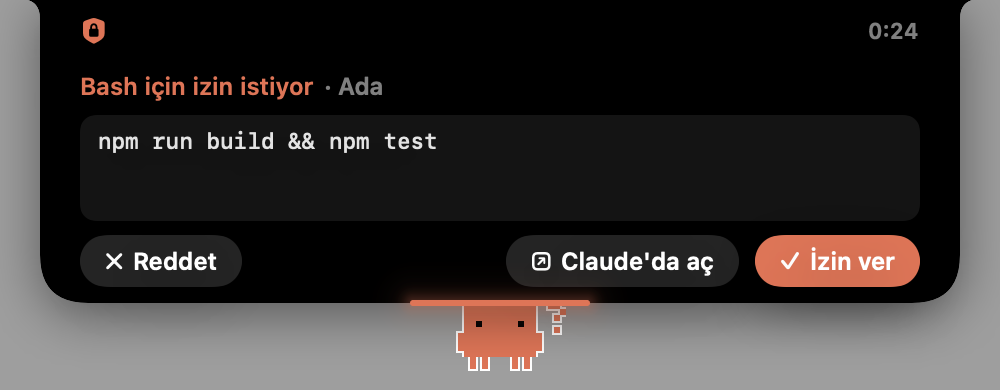
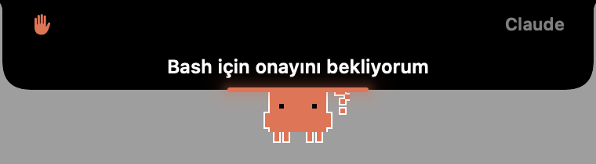
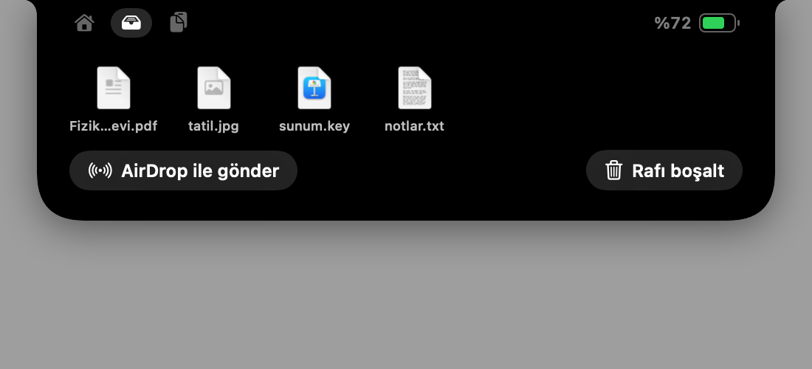
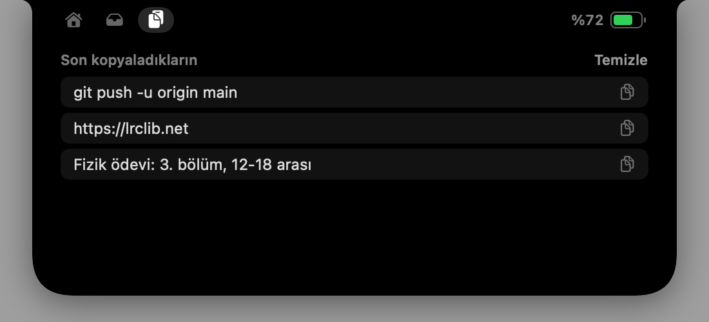

# Ada 🏝️

**MacBook çentiği için Dinamik Ada**: zamanlı şarkı sözleriyle müzik, Claude Code için canlı etkinlik (izin isteklerini çentikten cevaplayabilirsin), AirDrop'lu dosya rafı, pano geçmişi, ses göstergesi ve sıradaki takvim etkinliğin.

[English](README.md) · **Türkçe**

Ada, MacBook'unun çentiğinin üstüne oturur ve bir şey olduğunda küçük bir adaya dönüşür: bir şarkı başladığında, şarj kablosunu taktığında, Claude Code izin istediğinde ya da işini bitirdiğinde.

<p align="center">
  
  
</p>
<p align="center">
  
</p>
<p align="center">
  
</p>
<p align="center">
  
  
</p>
<p align="center">
  
  
</p>

> Ekran görüntülerini uygulamanın kendisi örnek verilerle çiziyor (`--snapshot`). İçlerindeki şarkı sözleri, dosyalar ve pano yazıları uydurma.

## Özellikler

### 🎵 Müzik
- **Çalarken küçük görünüm:** solda albüm kapağı, sağda kapağın renginde zıplayan ekolayzer, çentiğin hemen altında *şarkı · sanatçı*.
- **Üstüne gelince büyür:** kapak, şarkı adı, ⏮ ⏯ ⏭ ve sürüklenebilir ilerleme çubuğu. Kapağa tıklarsan müzik uygulaması öne gelir.
- **Zamanlı şarkı sözleri:** [LRCLIB](https://lrclib.net)'ten gelir. O an söylenen satır parlak görünür, satırlar şarkıyla birlikte kayar. Sözü olmayan şarkılarda bu alan hiç çıkmaz.
- **İki parmakla kaydırma:** panel açıkken sağa kaydırınca sonraki şarkı, sola kaydırınca önceki şarkı. Yeterince kaydırınca trackpad hafifçe "tık"lar.
- **Akıllı boşta modu:** müzik 2 dakikadır duraklatılmışsa panel saat ve tarihe döner; yanında kaldığın yerden devam etmek için "Son çalan ▶" butonu olur.
- **Müzik** (Apple Music) ve **Spotify** uygulamalarıyla çalışır.

### 🤖 Claude Code canlı etkinliği
Bir piksel maskot sana [Claude Code](https://claude.com/claude-code)'un ne yaptığını gösterir. Claude Code kancalarıyla çalışır (bkz. [kurulum](#claude-code-bağlantısı-isteğe-bağlı)).

| Ne zaman | Çentikte |
|---|---|
| Mesaj gönderdiğinde | Solda yürüyen mini maskot, sağda geçen süre (`1:23`) |
| Claude izin isteyince | Araç, klasör ve komutun yazdığı bir kart, geri sayım ve **Reddet** · **Claude'da aç** · **İzin ver** butonları |
| Claude kendi penceresinde onayını beklerken | Maskot zıplayan bir **?** ile çıkar: "Bash için onayını bekliyorum" |
| Claude işini bitirince | Turuncu bir çizgi yanar, maskot çıkar: "İşim bitti · *klasör*" (10 saniye). Sonra sen bakana kadar ✓ işareti kalır |

Fareyle çentiğe gelince panelin üstünde bir Claude satırı çıkar; **Aç**'a basınca Claude uygulaması öne gelir. ✓ işareti, paneli açınca, Claude'a geçince ya da yeni mesaj yazınca kalkar. Claude Code'u terminalde kullanıyorsan bu satırda **kullanım limitlerin** de görünür: "5 sa %42 · hafta %18", 5 saatlik pencerenin %42'sinin, haftalık pencerenin %18'inin dolduğu anlamına gelir.

#### İzin isteklerini çentikten cevaplamak
Claude Code bir şey için izin isteyeceği zaman Ada isteği çentikte gösterir; uygulama değiştirmeden cevap verebilirsin.
- **İzin ver** sadece **bu tek isteğe** izin verir. Ada asla kalıcı izin kuralı eklemez, izin modunu değiştirmez.
- **Reddet** isteği reddeder ve Claude'a Ada'dan reddedildiğini söyler.
- **Claude'da aç** dersen ya da **30 saniye** içinde cevap vermezsen istek Claude'un kendi izin penceresine geri döner; Ada hiç yokmuş gibi.
- Claude uygulamasını kullanıyorsan ve o zaten öndeyse Ada araya girmez, Claude kendi penceresini hemen açar.
- Komutun tamamı karta sığmıyorsa (180 karakterden uzunsa) **İzin ver** butonu çıkmaz; önce Claude'da oku.
- Kart çıktıktan sonraki ilk 0,8 saniye **İzin ver**'e tıklama sayılmaz; başka bir şeye tıklarken yanlışlıkla izin verilmesin diye.
- Sorular (`AskUserQuestion`) ve plan onayı her zaman Claude'da kalır.
- Cevap, sadece senin kullanıcı hesabının açabildiği yerel bir soketten gider. İzin vermenin tek yolu karttaki butona tıklamak.

### 🗂️ Dosya rafı
Bir dosyayı çentiğe sürükle; panel **raf** sekmesinde açılır, oraya bırak. Sonra oradan istediğin yere sürükleyebilir, tıklayıp açabilir ya da sağ tıklayıp *Finder'da göster*, *AirDrop ile gönder*, *Raftan kaldır* diyebilirsin. **AirDrop ile gönder** raftaki her şeyi gönderir. Ada sadece dosyaların nerede olduğunu hatırlar (en fazla 12), kopyalamaz.

### 📋 Pano geçmişi (varsayılan olarak kapalı)
**Pano** sekmesi kopyaladığın son 10 yazıyı tutar. Birine tıklayınca tekrar kopyalanır. Sekmeden ya da menü çubuğundaki ikondan açabilirsin.
- Sadece bellekte durur: diske hiçbir şey yazılmaz, Ada kapanınca liste silinir.
- Şifre yöneticilerinin "gizli" diye işaretlediği kopyalamalar kaydedilmez.
- Yeni macOS sürümleri, bir uygulama panoyu okumadan önce sana sorar. Sistem Ayarları'nda (Gizlilik ve Güvenlik) Ada'ya "her zaman izin ver" de. Yoksa Ada her kopyalamada macOS'un soru sormasına yol açmak yerine panoyu okumayı bırakır.

### ⚡ Ayrıca
- **Ses göstergesi:** ses değişince çentikte hoparlör ve seviye çubuğu çıkar. Ada sesi sadece *okur*, asla değiştirmez.
- **Sıradaki etkinlik:** bir şey çalmıyorken panel, önümüzdeki 24 saatteki ilk takvim etkinliğini gösterir ("Fizik dersi · 16:19 · 25 dk sonra"). Ada takvim iznini sadece sen **Takvimi göster**'e basınca ister ve sadece okur.
- **Şarj bildirimi:** kabloyu takınca "⚡ Şarj oluyor %72".
- **Terminalden mesaj:** `ada "derleme bitti"` yazınca çentikte görünür.
- **Mac açılınca başlama** ve menü çubuğunda ayar ikonu.
- **Hafif:** yaklaşık 37 MB RAM, boştayken ~%1 işlemci. Sürekli dönen animasyonları uygulama değil Core Animation yürütür.

## Gereksinimler
- Çentikli bir MacBook. Diğer Mac'lerde Ada ekranın üst ortasında küçük bir hap şeklinde görünür.
- macOS 14 veya üstü (macOS 27'de geliştirildi).
- Xcode **ya da** sadece Command Line Tools: `xcode-select --install` (Swift 5.9+).
- Şarkı bilgisi için Müzik ya da Spotify uygulaması.

## Kurulum

### Homebrew ile
```bash
brew tap lonlyexe0/ada https://github.com/lonlyexe0/Ada
brew install --HEAD lonlyexe0/ada/ada
ditto "$(brew --prefix)/opt/ada/Ada.app" ~/Applications/Ada.app && open ~/Applications/Ada.app
```
Homebrew Ada'yı kaynaktan derler ve [terminalden mesaj](#terminalden-mesaj-isteğe-bağlı) için `ada` komutunu da kurar. Uygulamayı `~/Applications`'a kopyalamak, Mac açılınca başlamanın ve Claude Code kancalarının çalışması için. Güncellemek için: `brew upgrade --fetch-HEAD ada`, sonra tekrar kopyala.

### Kaynaktan
```bash
git clone https://github.com/lonlyexe0/Ada.git
cd Ada
./build.sh
```
`build.sh` uygulamayı derler, `~/Applications/Ada.app` olarak kurar ve açar. Ada ilk açılışta kendini Giriş Öğeleri'ne ekler; menü çubuğundaki ikondan kapatabilirsin.

macOS **"Ada, Müzik'i kontrol etmek istiyor"** diye sorunca **İzin Ver**'e bas. Ada çalan şarkıyı bu sayede okuyor.

- Kapatmak için: menü çubuğundaki kapsül ikonu → **Ada'dan çık**.
- Kurmadan sadece derlemek için: `./build.sh --no-run`.

## Claude Code bağlantısı (isteğe bağlı)
[`scripts/claude-hooks.json`](scripts/claude-hooks.json) dosyasındaki `"hooks"` bölümünü `~/.claude/settings.json` dosyana ekle; kullanım limitlerini de görmek istiyorsan `"statusLine"`ı da. Orada zaten kanca varsa üzerine yazma, birleştir. Zaten bir durum satırın (status line) varsa kendininkini koru, `statusLine`ı ekleme.

| Kanca | Ada'ya ne söyler |
|---|---|
| `UserPromptSubmit` | Claude çalışmaya başladı → mini maskot + sayaç |
| `PostToolUse` | Bir araç bitti → tekrar "çalışıyor" (örneğin bir şeyi onayladıktan sonra) |
| `Notification` | Claude kendi penceresinde onayını bekliyor → "?"lı maskot |
| `PermissionRequest` | Claude izin istiyor → çentikteki kart. Claude cevabın için en fazla 30 saniye bekler, sonra kendi penceresini açar. |
| `Stop` | Claude bitirdi → bildirim + ✓ işareti |
| `statusLine` | Sadece terminaldeki Claude Code: Claude satırı için kullanım limitleri |

İlk üç kanca arka planda çalışır ve her biri yaklaşık 0,07 saniye sürer, yani Claude'u yavaşlatmaz. `PermissionRequest` ise cevabını beklemek zorunda. 30 saniyelik süreyi değiştirmek için komutunun başına `ADA_PERMISSION_WAIT=15` ekle. Yeni kancaların devreye girmesi için Claude Code'da yeni bir oturum açman gerekebilir.

## Terminalden mesaj (isteğe bağlı)
Homebrew `ada` komutunu zaten kurar. Kaynaktan derlediysen:
```bash
mkdir -p ~/.local/bin
cp scripts/ada ~/.local/bin/ && chmod +x ~/.local/bin/ada
echo 'export PATH="$HOME/.local/bin:$PATH"' >> ~/.zshrc   # sonra yeni bir terminal penceresi aç

ada "lab7 bitti!"
python3 uzun_islem.py; ada "İşlem bitti"
```

## Menü çubuğu
Menü çubuğundaki kapsül ikonunda şunlar var:
- **Mac açılınca başlat**
- **Claude maskotunu göster** (kapalıyken çizgi ve yazı yine çıkar)
- **Ses göstergesi**
- **Pano geçmişi**
- **Ada'dan çık**

## Sorun giderme
| Sorun | Çözüm |
|---|---|
| Şarkı görünmüyor | `open -n -W --stdout /tmp/ada.txt ~/Applications/Ada.app --args --probe; cat /tmp/ada.txt`: Müzik'e adım adım soru sorar ve cevaplarını yazar. |
| Müzik iznini yanlışlıkla reddettin | Sistem Ayarları → Gizlilik ve Güvenlik → Otomasyon → Ada → Müzik, ya da `tccutil reset AppleEvents local.ada.island` |
| Bir şarkının sözü var mı? | Aynı komutu `--probe --song "Şarkı" --artist "Sanatçı"` ile çalıştır (sadece satır sayısını yazar) |
| İzin kartı çıkmıyor | `~/.claude/settings.json` içinde `PermissionRequest` olduğundan emin ol ve Claude Code'da yeni oturum aç. Claude uygulaması öndeyse Ada bilerek araya girmez. İstek gelince `tail ~/Library/Logs/Ada.log` çıktısında `izin isteği` yazar. |
| Pano sekmesi macOS'un sürekli sorduğunu söylüyor | Sistem Ayarları'nda (Gizlilik ve Güvenlik) Ada'nın pano erişimini "her zaman izin ver" yap. |
| Takvim iznini reddettin | Sistem Ayarları → Gizlilik ve Güvenlik → Takvimler → Ada |
| Pencere açmadan tasarımı görmek | `build/Ada.app/Contents/MacOS/Ada --snapshot snapshots` her hali PNG olarak çizer |
| Mac açılınca başlama açık mı? | `open -n -W --stdout /tmp/ada.txt ~/Applications/Ada.app --args --login-status; cat /tmp/ada.txt` |
| Mesaj ya da kanca Ada'ya ulaştı mı? | `tail ~/Library/Logs/Ada.log` (sadece olayın türü yazılır, içeriği asla) |

## Nasıl çalışıyor
- **Çalan şarkı:** AppleScript, Müzik / Spotify uygulamasına 1,5 saniyede bir sorar. Uygulama bir değişiklik duyurduğunda da hemen güncellenir. Çal/duraklat ve ileri sarma gibi komutlar da AppleScript'le gider.
- **Sözler:** [LRCLIB](https://lrclib.net) (ücretsiz, anahtar gerektirmez). Önce birebir eşleşme dener (ad, sanatçı, albüm, süre), bulamazsa arar. Süresi 10 saniyeden fazla farklı olan versiyonları eler.
- **Mesajlar ve kancalar:** `Ada --say` / `Ada --claude-event` sistem genelinde bir duyuru (distributed notification) yayınlar, çalışan Ada onu yakalar.
- **İzin istekleri:** kanca (`Ada --claude-permission`), `~/Library/Application Support/Ada/permission.sock` soketine bağlanır (klasör 700, soket 600), isteğin kısa bir özetini gönderir ve bekler. Çalışan Ada kartı gösterir ve senin tıklamanla cevap verir. Süre dolarsa "pas" der, kanca hiçbir şey yazmaz ve Claude kendi penceresini açar. Kanca kaybolursa (Claude'u durdurduysan) kart da kalkar.
- **Kullanım limitleri:** `Ada --statusline`, durum satırına gelen verideki `rate_limits` bilgisini okur ve yüzdeleri Ada'ya iletir.
- **Dosya sürükleme:** fare tuşuna bastığında Ada sürükleme panosunun sayacını not alır. Tuş basılıyken sayaç değişir ve içinde dosya varsa bir dosya sürükleniyordur; çentiğe gelince panel raf sekmesinde açılır. Sen bırakana kadar hiçbir şey okunmaz.
- **Ses:** varsayılan ses çıkışının CoreAudio özelliklerini dinler (sadece okuma).
- **Takvim:** EventKit ile, sadece okuma. Takvimin değişince ve 5 dakikada bir yenilenir.
- **Pencere:** menü çubuğunun da üstünde duran, kenarlıksız ve tıklamaları geçiren bir panel. Çentiğin ölçüsü `NSScreen.safeAreaInsets` ve `auxiliaryTopLeftArea` / `auxiliaryTopRightArea` ile okunur.
- **Animasyonlar:** ekolayzer ve maskot Core Animation katmanları; neredeyse hiç işlemci harcamaz. SwiftUI `TimelineView` ile çizdirince her karede bütün pencere yeniden çiziliyordu (boşta bile ~%6 işlemci).
- **Xcode gerekmez:** SwiftPM ve Command Line Tools ile derlenir. macOS 27 SDK'sında sadece Command Line Tools varken SwiftUI'nin `@State` makrosu çalışmadığı için kodda `@State` kullanılmıyor.

## Gizlilik
- **Sözler:** şarkının adı, sanatçısı, albümü ve süresi lrclib.net'e gönderilir. Bunun dışında Mac'inden bir şey çıkmaz (Spotify'ın kendi kapak resmi bağlantıları hariç).
- **Claude Code kancaları:** Ada sadece oturum kimliğini, klasör adını ve bildirim metnini okur. Mesajlarını ya da Claude'un cevaplarını asla okumaz.
- **İzin istekleri:** araç adı, klasör adı ve isteğin kısa bir özeti (en fazla 180 karakter, örneğin komut) Claude Code'dan Ada'ya yerel soketle gider. Kayıt dosyasına sadece araç adı yazılır.
- **Pano:** varsayılan olarak kapalı, sadece bellekte tutulur, gizli ya da geçici kopyalamalar (şifre yöneticileri) kaydedilmez.
- **Dosya rafı:** sadece dosya yolları Ada'nın ayarlarına kaydedilir.
- **Takvim:** sadece sen izin verince okunur; etkinlikler Mac'inden çıkmaz.
- **Kayıt dosyası:** sadece olay türleri ve mesaj uzunlukları yazılır, içerikleri asla.
- Analiz, hesap, takip yok.

## Sınırlamalar
- Tarayıcıda çalan müzik (YouTube, Spotify Web) görünmez. macOS 15.4'ten beri Apple, sistemin "şu an çalan" bilgisini sadece kendi uygulamalarına veriyor.
- Parlaklık göstergesi yok: macOS'ta parlaklık değişimini haber veren herkese açık bir arayüz yok.
- Kullanım limitleri sadece Claude Code'u terminalde kullanırsan görünür; Claude masaüstü uygulamasında durum satırı yok.
- Çentikten cevap vermek için 30 saniyen var; sonra istek Claude'un kendi penceresine döner. Uzun komutlar (180 karakterden uzun) Claude'da onaylanmalı.
- Uygulama geçici (ad hoc) imzalı. Hazır indirmek yerine kendin derle (`./build.sh` ya da Homebrew).

## Proje yapısı
| Dosya | Ne işe yarıyor |
|---|---|
| `AdaMain.swift` | Giriş noktası ve komut satırı seçenekleri (`--say`, `--claude`, `--claude-permission`, `--statusline`, `--probe`, `--snapshot`, ...) |
| `AppDelegate.swift` | Menü çubuğu ikonu ve menüsü, Mac açılınca başlama |
| `IslandController.swift` | Çentiğin üstündeki pencere, fare takibi, haller ve boyutlar, kaydırma hareketi, dosya sürükleme algılama |
| `IslandViews.swift` | Adanın bütün SwiftUI görünümleri (küçük haller, izin kartı, sekmeli büyük panel) |
| `Components.swift` | Çentik şekli, ekolayzer, pil, butonlar, ilerleme çubuğu |
| `NowPlaying.swift` | Çalan şarkıyı okuma ve kontrol etme |
| `AppleScript.swift` | Müzik / Spotify'a gönderilen AppleScript'ler |
| `Lyrics.swift` | LRCLIB bağlantısı, LRC okuyucu, kayan söz görünümü |
| `Mascot.swift` | Piksel maskot (büyük ve mini hali), Core Animation ile |
| `ClaudeActivity.swift` | Claude ne yapıyor: çalışıyor / onay bekliyor / bitirdi; kullanım limitleri |
| `Permissions.swift` | İzin isteklerini çentikten cevaplamak: yerel soket, istek sırası, `--claude-permission` kancası |
| `Usage.swift` | Durum satırından kullanım limitleri (`--statusline`) |
| `Shelf.swift` | Dosya rafı sekmesi, sürükle-bırak, AirDrop |
| `Clipboard.swift` | Pano geçmişi sekmesi (sadece bellekte) |
| `Agenda.swift` | Sıradaki takvim etkinliği (EventKit, sadece okuma) |
| `Volume.swift` | Ses göstergesi (CoreAudio, sadece okuma) |
| `Messages.swift` | Terminal ve Claude mesajları, `~/Library/Logs/Ada.log` |
| `Battery.swift` | Pil yüzdesi ve şarj kablosu |
| `Snapshot.swift` / `Probe.swift` | `--snapshot` ve `--probe` geliştirici araçları |
| `Formula/ada.rb` | Homebrew formülü |

## Not
Ada resmi olmayan bir hayran projesidir; Apple ya da Anthropic ile bağlantısı yoktur ve onlar tarafından desteklenmez. "Claude", Anthropic'in ticari markasıdır; piksel maskot hayran yapımı bir saygı çizimidir. Şarkı sözleri sahiplerine aittir. Bu projede hiçbir şarkı sözü bulunmaz, sözler çalışırken LRCLIB'den çekilir.
